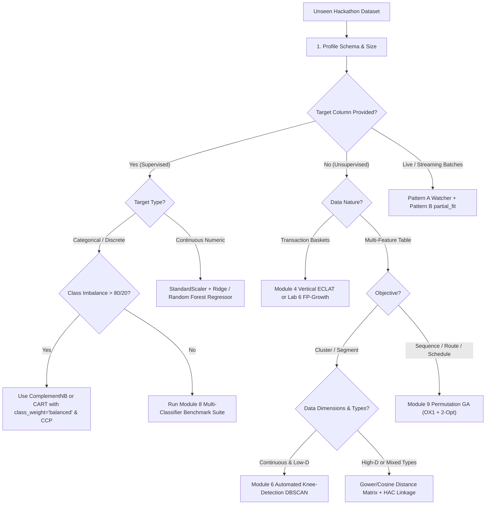

# 🏆 BIG DATA CURRICULUM: HACKATHON_PLAYBOOK.md
## Tactical Playbook: Problem Triage, Streaming Engines & Unfamiliar Problem Adaptations

This playbook provides actionable frameworks, rapid triage protocols, streaming data handlers, and operational adaptations to dominate an unfamiliar Big Data hackathon challenge within strict time limits.

---

## ⏱️ The 10-Minute Rapid Triage Protocol

When the hackathon prompt and dataset are revealed, execute this 10-minute diagnostic protocol before writing any modeling code:

```
[MINUTE 0-2] ──► Inspect File Manifest, Format (CSV/Parquet/JSON/SQLite) & Total Byte Size
[MINUTE 2-4] ──► Ingest Sample & Run audit_dataset() (Missingness, Cardinality, Inferred Types)
[MINUTE 4-6] ──► Determine Task Paradigm (Supervised, Unsupervised, FIM, Combinatorial, Streaming)
[MINUTE 6-8] ──► Check Target Variable Distribution & Class Balance (if Supervised)
[MINUTE 8-10] ─► Select Algorithmic Archetype & Establish Baseline Evaluation Metric
```

### Diagnostic Decision Flowchart



---

## 🎯 5 Core Adaptations to Unfamiliar Hackathon Domains

### Adaptation 1: High-Velocity IoT Telemetry & Industrial Anomaly Detection
- **Unfamiliar Scenario:** Telemetry data from hundreds of factory sensors, smart grid meters, or vehicle engines arriving continuously with transient sensor errors, voltage spikes, and equipment failures.
- **Curriculum Adaptation:**
  1. *Statistical Baseline (Lab 4 & 5):* Apply rolling window Tukey IQR fences (`cap_iqr_outliers`) to flag instantaneous voltage/temperature anomalies.
  2. *Multivariate Density Filtering (Lab 11):* Run Automated Knee DBSCAN on sliding 5-minute sensor windows. Any sensor point labeled `-1` (noise) is flagged as a potential equipment anomaly or multi-sensor discrepancy.
  3. *Failure Classification (Lab 9):* Train a CART Decision Tree on past labeled incident logs with `decision_path` tracing so maintenance engineers receive human-interpretable alerts (e.g., `"Alert: Sensor_4 > 85.2°C AND Vibration > 4.1 mm/s"`).

---

### Adaptation 2: E-Commerce Basket Recommendation & Cross-Selling
- **Unfamiliar Scenario:** Digital storefront or retail POS data requiring real-time product recommendations, bundle creation, or checkout add-on suggestions.
- **Curriculum Adaptation:**
  1. *Relational Assembly (Lab 5):* Use SQLite / Pandas to join order headers, customer demographics, and line-item tables into aggregated customer basket lists.
  2. *Sub-Second Pattern Mining (Lab 7 & Module 4):* Execute Vertical ECLAT with TID-sets to mine frequent co-purchases under 200 milliseconds.
  3. *Non-Redundant Rules (Lab 8):* Filter frequent itemsets using AClose closure rules so redundant sub-rules are discarded, serving only maximal high-lift recommendations.

---

### Adaptation 3: Financial Fraud Detection & Extreme Class Imbalance (< 1% Positives)
- **Unfamiliar Scenario:** Credit card transactions, insurance claims, or loan applications where fraudulent records constitute $< 1\%$ of the dataset, rendering standard accuracy metrics completely misleading.
- **Curriculum Adaptation:**
  1. *Metric Reorientation:* Discard Accuracy. Track **PR-AUC (Precision-Recall AUC)**, **Macro-F1**, and **False Negative Rate (Recall)**.
  2. *Complement Naive Bayes (Lab 10):* Deploy `ComplementNB`, which explicitly estimates parameter distributions from non-fraudulent instances, mitigating minority class under-representation.
  3. *Cost-Complexity Pruned Trees (Lab 9):* Fit `DecisionTreeClassifier(class_weight='balanced')`, compute effective alpha pruning paths, and select $\alpha^*$ maximizing PR-AUC on validation folds.
  4. *Decision Threshold Shifting:* Sweep threshold $\theta \in [0.05, 0.50]$ instead of defaulting to 0.5 to optimize operational ROI.

---

### Adaptation 4: Smart Logistics, Vehicle Routing & Dispatch Optimization
- **Unfamiliar Scenario:** Delivery fleet routing, warehouse pick-path planning, or multi-depot vehicle dispatch requiring shortest tour solutions.
- **Curriculum Adaptation:**
  1. *Cost Matrix Computation (Lab 4 & 11):* Calculate the $N \times N$ pairwise distance matrix using Manhattan distance ($L_1$, city grid) or Euclidean distance ($L_2$).
  2. *Metaheuristic Permutation GA (Lab 12 & Module 9):* Initialize population with random permutations of dispatch waypoints. Apply **Order Crossover (OX1)** to preserve sub-route ordering without duplicating delivery stops, and **2-Opt Inversion Mutation** to untangle crossing paths.
  3. *Convergence Acceleration:* Track best tour distance per generation; terminate if improvement $< 0.1\%$ over 20 generations.

---

### Adaptation 5: High-Dimensional Behavioral Persona Segmentation
- **Unfamiliar Scenario:** User clickstream, gaming telemetry, or SaaS application telemetry requiring behavioral grouping without ground truth labels.
- **Curriculum Adaptation:**
  1. *Skewness Rectification (Lab 5 & Module 3):* Behavioral frequencies (session lengths, clicks, page views) are heavily right-skewed; apply `np.log1p` across numeric columns.
  2. *Automated Density Discovery (Lab 11 & Module 6):* Run KneeLocator on the sorted $k$-distance curve to select $\varepsilon$, isolating bot traffic / web scrapers into noise cluster `-1`.
  3. *Cluster Interpretability (Lab 10):* Profile cluster medians across original unscaled behavioral dimensions to assign human personas (e.g., "High-Intent Shopper", "Window Browser", "Bargain Hunter").

---

## ⚡ Live & Streaming Dataset Operational Engines

### Engine A: Directory File-Drop Watcher (Micro-Batch Streaming)
When datasets arrive as incremental CSV/JSON drops into an input directory, use this robust polling engine:

```python
import os
import time
import glob
import pandas as pd

def stream_directory_watcher(watch_dir: str, process_fn, poll_interval_sec: float = 2.0):
    """
    Watches an incoming folder for new tabular micro-batches,
    processing each file exactly once in chronological arrival order.
    """
    processed_files = set()
    print(f"[*] Watching directory: {watch_dir} for streaming drops...")
    
    try:
        while True:
            file_pattern = os.path.join(watch_dir, "*.csv")
            current_files = sorted(glob.glob(file_pattern), key=os.path.getmtime)
            
            for file_path in current_files:
                if file_path not in processed_files:
                    try:
                        # Ensure file write is completed by sender
                        file_size_1 = os.path.getsize(file_path)
                        time.sleep(0.2)
                        file_size_2 = os.path.getsize(file_path)
                        if file_size_1 != file_size_2 or file_size_1 == 0:
                            continue
                            
                        df_batch = pd.read_csv(file_path)
                        print(f"[+] Ingested Batch: {os.path.basename(file_path)} ({len(df_batch)} rows)")
                        process_fn(df_batch)
                        processed_files.add(file_path)
                    except Exception as e:
                        print(f"[-] Error processing {file_path}: {e}")
                        
            time.sleep(poll_interval_sec)
    except KeyboardInterrupt:
        print("[!] Watcher stopped cleanly.")
```

---

### Engine B: Online Incremental Machine Learning (`partial_fit`)
When data volume exceeds RAM or arrives in continuous streams, standard `fit()` fails. Use incremental estimators supporting `.partial_fit()`:

```python
import numpy as np
from sklearn.linear_model import SGDClassifier
from sklearn.preprocessing import StandardScaler

class OnlineStreamClassifier:
    """
    Incremental classifier that updates its model parameters in real-time
    as new micro-batches arrive without retraining on past data.
    """
    def __init__(self, classes: np.ndarray):
        self.classes = classes
        self.scaler = StandardScaler()
        # SGD with log_loss implements incremental Logistic Regression
        self.clf = SGDClassifier(loss='log_loss', penalty='l2', alpha=1e-4, random_state=42)
        self.initialized = False
        
    def update(self, X_batch: np.ndarray, y_batch: np.ndarray):
        """Processes an incoming micro-batch."""
        # Partial fit on scaler
        self.scaler.partial_fit(X_batch)
        X_scaled = self.scaler.transform(X_batch)
        
        # Incremental model update
        if not self.initialized:
            self.clf.partial_fit(X_scaled, y_batch, classes=self.classes)
            self.initialized = True
        else:
            self.clf.partial_fit(X_scaled, y_batch)
            
    def predict_proba(self, X_query: np.ndarray) -> np.ndarray:
        X_scaled = self.scaler.transform(X_query)
        return self.clf.predict_proba(X_scaled)
```

---

## ⌛ 60-Minute Hackathon Battle Plan

| Time Window | Phase Goal | Exact Actions & Deliverables |
|---|---|---|
| **00:00 – 00:10** | **Triage & Audit** | Ingest dataset, run `audit_dataset()`, classify problem paradigm, check missingness & skewness. |
| **00:10 – 00:20** | **Clean & Transform** | Clip IQR outliers, apply `np.log1p` on skewed attributes, build `ColumnTransformer` with `handle_unknown='ignore'`. |
| **00:20 – 00:40** | **Model & Mine** | Fit primary algorithms (Module 6 DBSCAN, Module 4 ECLAT, or Module 8 Multi-Classifier Suite). |
| **00:40 – 00:50** | **Validate & Tune** | Evaluate cross-validation Macro-F1 / Silhouette / PR-AUC. Optimize decision threshold $\theta$. |
| **00:50 – 00:60** | **Visualize & Conclude** | Generate clean plots (ROC curve, PCA cluster scatter, Pareto bar), extract top 3 business takeaways. |
