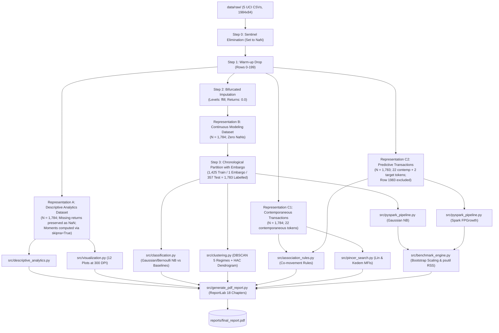

# SYSTEM ARCHITECTURE & ENGINEERING SPECIFICATION
*(Fully Reconciled & Audited Version)*

**Project:** Analytics and Systems of Big Data Practice — Endsem Hackathon  
**Target:** Modular, Maintainable, Reproducible Data Science & Big Data Engineering System  

---

## 1. Directory Structure

```
lab_hackathon/
│
├── data/
│   ├── raw/                               # Immutable original UCI source CSVs (5 files, 1984x84)
│   │   ├── Processed_S&P.csv
│   │   ├── Processed_DJI.csv
│   │   ├── Processed_NASDAQ.csv
│   │   ├── Processed_NYSE.csv
│   │   └── Processed_RUSSELL.csv
│   ├── interim/                           # Cleaned, sentinel-free Parquet representations
│   │   ├── descriptive_sp500.parquet      # Representation A: N = 1,784, missing returns preserved as NaN
│   │   └── harmonized_multimarket.parquet # Harmonized multi-market interim data
│   └── processed/                         # Dense modeling matrices & transaction databases
│       ├── sp500_train.parquet            # Representation B: N = 1,425 rows (orig 200–1624, post 0–1424)
│       ├── sp500_embargo.parquet          # Representation B: N = 1 row (orig 1625, post 1425, 2016-06-16)
│       ├── sp500_test.parquet             # Representation B: N = 357 rows (orig 1626–1982, post 1426–1782)
│       ├── transactions_contemp.json      # Representation C1: N = 1,784 baskets (22 contemporaneous tokens)
│       └── transactions_predictive.json   # Representation C2: N = 1,783 baskets (22 contemp + 2 target tokens)
│
├── notebooks/                             # Interactive, fully documented Jupyter notebooks
│   ├── 01_dataset_exploration.ipynb       # Profiling, sentinels, null audit, column registry
│   ├── 02_data_preprocessing.ipynb        # Sentinel cleaning, warm-up drop, 3 representations, embargo split
│   ├── 03_descriptive_analytics.ipynb     # Moments, skewness, kurtosis, Jarque-Bera, Ljung-Box on Rep A
│   ├── 04_visualization.ipynb             # 12 curriculum-aligned publication plots with post-rendering inferences
│   ├── 05_fp_growth.ipynb                 # FP-Tree mining, predictive vs contemporaneous rules on Rep C1/C2
│   ├── 06_naive_bayes_and_dbscan.ipynb    # Gaussian/Bernoulli NB vs baselines + DBSCAN regimes on Rep B
│   ├── 07_pincer_search_mfi.ipynb         # Lin & Kedem Pincer Search & dual oracle validation on Rep C
│   └── 08_pyspark_comparison.ipynb        # PySpark Gaussian NB & FPGrowth pipelines & benchmarking
│
├── src/                                   # Production-ready Python modules
│   ├── __init__.py
│   ├── data_loader.py                     # UCI fetcher, SHA-256 verifier, column registry
│   ├── preprocessing.py                   # Sentinel cleaner, warm-up drop, 3 data representations, embargo split
│   ├── feature_engineering.py             # Stationary spreads, target builder, 24-item discretizer
│   ├── descriptive_analytics.py           # Distributional moments, normality, autocorrelation on Rep A
│   ├── visualization.py                   # 12 high-resolution curriculum visualization generators (300 DPI)
│   ├── association_rules.py               # FP-Growth integer engine, conviction, rule pruning
│   ├── classification.py                  # Gaussian/Bernoulli NB, likelihood tables, McNemar test
│   ├── clustering.py                      # DBSCAN on 5 regime features, knee detection, DBCV, HAC
│   ├── pincer_search.py                   # Hardened Lin & Kedem bi-directional Pincer Search algorithm
│   ├── pyspark_pipeline.py                # PySpark MLlib Gaussian NB & FPGrowth, toPandas export
│   ├── benchmark_engine.py                # Latency phases, psutil process-tree RSS, bootstrap scaling
│   └── generate_pdf_report.py             # ReportLab automated academic PDF builder (18 chapters)
│
├── outputs/                               # Generated reproducible outputs
│   ├── figures/                           # 300 DPI high-resolution plots (fig01 to fig17)
│   ├── tables/                            # CSV and Markdown metric summaries
│   ├── models/                            # Serialized model artifacts (Pickle / Spark ML)
│   └── metrics/                           # JSON benchmarking and evaluation logs
│
├── tests/                                 # Pytest automated test suite (25 formal assertions)
│   ├── __init__.py
│   ├── test_data_loader.py
│   ├── test_preprocessing.py
│   ├── test_feature_engineering.py
│   ├── test_fp_growth.py
│   ├── test_pincer_search.py
│   ├── test_classification.py
│   ├── test_clustering.py
│   ├── test_pyspark.py
│   ├── test_benchmark.py
│   └── test_report.py
│
├── reports/                               # Final examination deliverables
│   └── Analytics_BigData_Endsem_Report.pdf
│
├── planning/                              # Planning and reconciliation deliverables
│   ├── DATASET_ANALYSIS_PLAN.md
│   ├── REQUIREMENTS_TRACEABILITY.md
│   ├── IMPLEMENTATION_ROADMAP.md
│   ├── ARCHITECTURE.md
│   ├── TEST_PLAN.md
│   ├── MVP_SPECIFICATION.md
│   ├── AUDIT_RECONCILIATION.md
│   └── FINAL_IMPLEMENTATION_SPECIFICATION.md
│
├── requirements.txt                       # Pinned Python package dependencies
├── README.md                              # Master project overview and execution instructions
└── run_all.py                             # Single-command end-to-end execution runner
```

---

## 2. Core Module Architecture & Data Flow



---

## 3. Component Responsibilities & Interfaces

### 3.1 `src/data_loader.py`
- **Responsibility:** Ingest raw CSV files; compute and verify SHA-256 checksums; harmonize cross-market peer index names; author column-type registry (`level_price`, `level_rate`, `return_frac`, `return_pct`, `rel_change`).
- **Public Interface:**
  - `fetch_uci_dataset(dest_dir: Path) -> dict[str, Path]`
  - `load_market_csv(market_name: str, raw_dir: Path) -> pd.DataFrame`
  - `build_column_type_registry() -> pd.DataFrame`
  - `harmonize_schemas(dfs: dict[str, pd.DataFrame]) -> dict[str, pd.DataFrame]`

### 3.2 `src/preprocessing.py`
- **Responsibility:** Execute Step 0 sentinel elimination; truncate warm-up rows ($t < 200$); construct the three separate data representations:
  - `build_descriptive_dataset(df: pd.DataFrame)` $\rightarrow$ Representation A (preserves NaNs in returns).
  - `build_modeling_dataset(df: pd.DataFrame)` $\rightarrow$ Representation B (levels: `ffill`; returns: `0.0`).
  - `partition_chronological_with_embargo(df: pd.DataFrame)` $\rightarrow$ 1,425 Train, 1 Embargo, 357 Test ($1,425 + 1 + 357 = 1,783$).
- **Public Interface:**
  - `eliminate_sentinels(df: pd.DataFrame) -> tuple[pd.DataFrame, dict]`
  - `truncate_warmup_period(df: pd.DataFrame, cutoff: int = 200) -> pd.DataFrame`
  - `build_three_representations(df: pd.DataFrame, registry: pd.DataFrame) -> dict`
  - `temporal_split_with_embargo(df: pd.DataFrame) -> tuple[pd.DataFrame, pd.DataFrame, pd.DataFrame]`

### 3.3 `src/feature_engineering.py`
- **Responsibility:** Construct forward next-day directional target (`NextDay_Up` vs `NextDay_NotUp`); engineer stationary moving average percentage spreads ($Close / EMA_k - 1$); generate contemporaneous ($N=1,784$, 22 tokens) and predictive ($N=1,783$, 24 tokens) transaction databases.
- **Public Interface:**
  - `create_binary_direction_target(df: pd.DataFrame) -> pd.DataFrame`
  - `engineer_stationary_spreads(df: pd.DataFrame) -> pd.DataFrame`
  - `select_task_relevant_features(train_df: pd.DataFrame, target_col: str) -> list[str]`
  - `build_contemporaneous_transactions(df: pd.DataFrame, train_thresholds: dict) -> list[set[str]]`
  - `build_predictive_transactions(df: pd.DataFrame, train_thresholds: dict) -> list[set[str]]`

### 3.4 `src/descriptive_analytics.py`
- **Responsibility:** Calculate comprehensive descriptive statistical metrics across all features on Representation A (mean, std, median, IQR, skewness, kurtosis, Jarque-Bera p-values, Ljung-Box p-values, units, missingness with `skipna=True`).
- **Public Interface:**
  - `compute_distributional_moments(df: pd.DataFrame, feature_cols: list[str]) -> pd.DataFrame`
  - `compute_normality_and_autocorrelation(df: pd.DataFrame, feature_cols: list[str]) -> pd.DataFrame`
  - `audit_missingness_and_sentinels(raw_df: pd.DataFrame) -> pd.DataFrame`

### 3.5 `src/visualization.py`
- **Responsibility:** Generate and export 12 publication-grade curriculum visualizations (300 DPI PNG) illustrating univariate, bivariate, multivariate, and temporal dynamics using Representation A.
- **Public Interface:**
  - `plot_multi_index_performance(dfs: dict[str, pd.DataFrame], output_path: Path) -> None`
  - `plot_return_distribution_and_kde(df: pd.DataFrame, output_path: Path) -> None`
  - `plot_asset_correlation_heatmap(df: pd.DataFrame, output_path: Path) -> None`
  - `plot_volatility_regime_boxplots(df: pd.DataFrame, output_path: Path) -> None`
  - `plot_missingness_matrix(raw_df: pd.DataFrame, output_path: Path) -> None`
  - `plot_rolling_volatility(df: pd.DataFrame, output_path: Path) -> None`
  - `plot_yield_curve_spreads(df: pd.DataFrame, output_path: Path) -> None`
  - `plot_credit_spread_vs_momentum(df: pd.DataFrame, output_path: Path) -> None`
  - `plot_autocorrelation_dynamics(df: pd.DataFrame, output_path: Path) -> None`
  - `plot_joint_macro_hexbin(df: pd.DataFrame, output_path: Path) -> None`
  - `plot_day_of_week_violin(df: pd.DataFrame, output_path: Path) -> None`
  - `plot_cumulative_drawdown(df: pd.DataFrame, output_path: Path) -> None`

### 3.6 `src/association_rules.py`
- **Responsibility:** Execute FP-Growth frequent itemset mining on integer count thresholds; compute Support, Confidence, Lift, and Conviction; prune redundant rules; bifurcate rules into predictive and contemporaneous sets.
- **Public Interface:**
  - `mine_fp_growth_itemsets(transactions: list[set[str]], min_support: float) -> pd.DataFrame`
  - `generate_association_rules(frequent_itemsets: pd.DataFrame, min_confidence: float) -> pd.DataFrame`
  - `filter_and_prune_rules(rules_df: pd.DataFrame) -> tuple[pd.DataFrame, pd.DataFrame]`

### 3.7 `src/classification.py`
- **Responsibility:** Train and evaluate Gaussian and Bernoulli Naive Bayes classifiers on Representation B (train $N=1,425$, test $N=357$); evaluate against 55.46% test majority baseline; extract class likelihood parameters as "classification rules".
- **Public Interface:**
  - `train_gaussian_naive_bayes(X_train: np.ndarray, y_train: np.ndarray) -> object`
  - `train_bernoulli_naive_bayes(X_train_bin: np.ndarray, y_train: np.ndarray) -> object`
  - `evaluate_classifier_vs_baselines(model: object, X_test: np.ndarray, y_test: np.ndarray, majority_rate: float) -> dict[str, float]`
  - `extract_classification_rules(model: object, feature_names: list[str]) -> pd.DataFrame`

### 3.8 `src/clustering.py`
- **Responsibility:** Execute DBSCAN on 5 domain regime features from Representation B; locate optimal $\varepsilon$ knee via k-distance graph; compute DBCV scores, non-noise silhouette scores, and cluster stability; generate Hierarchical Agglomerative Clustering dendrogram companion.
- **Public Interface:**
  - `compute_k_distance_knee(X: np.ndarray, k: int, output_path: Path) -> float`
  - `fit_dbscan_regimes(X: np.ndarray, eps: float, min_samples: int) -> tuple[np.ndarray, dict[str, float]]`
  - `evaluate_clustering_stability(X: np.ndarray, base_eps: float, min_samples: int) -> float`
  - `generate_regime_dendrogram(X: np.ndarray, output_path: Path) -> float`

### 3.9 `src/pincer_search.py`
- **Responsibility:** Implement Lin & Kedem (1998) bi-directional Pincer Search algorithm with sequential MFCS antichain branching and counting-pruning; discover all Maximal Frequent Itemsets; provide dual oracle cross-validation against `fpmax` and FP-Growth.
- **Public Interface:**
  - `class PincerSearch(transactions: list[set[str]], min_support: float)`
  - `PincerSearch.fit() -> set[frozenset]`
  - `validate_dual_oracles(pincer_mfis: set[frozenset], transactions: list[set[str]], min_support: float) -> bool`

### 3.10 `src/pyspark_pipeline.py`
- **Responsibility:** Manage Windows-safe local SparkSession; execute PySpark MLlib Distributed FP-Growth (`pyspark.ml.fpm.FPGrowth`) and Distributed Gaussian Naive Bayes (`pyspark.ml.classification.NaiveBayes` with `modelType='gaussian'`); export all results via `toPandas()`.
- **Public Interface:**
  - `get_or_create_spark_session(app_name: str = "BigData_Endsem") -> SparkSession`
  - `run_spark_fpgrowth(transactions: list[list[str]], min_support: float, min_confidence: float) -> tuple[pd.DataFrame, pd.DataFrame]`
  - `run_spark_gaussian_naive_bayes(train_df: pd.DataFrame, test_df: pd.DataFrame, feature_cols: list[str]) -> dict[str, float]`

### 3.11 `src/benchmark_engine.py`
- **Responsibility:** Execute controlled latency profiling (session, conversion, warmup, steady fit, collect); sample process-tree peak RSS via `psutil`; evaluate strong scaling with fitted Amdahl $f$; evaluate weak/data scaling across synthetic bootstrap-perturbed datasets ($N=1,784$ to $500,000$).
- **Public Interface:**
  - `benchmark_baseline_real_data(iterations: int = 5) -> pd.DataFrame`
  - `generate_bootstrap_synthetic_data(train_df: pd.DataFrame, target_n: int) -> tuple[pd.DataFrame, list[set[str]]]`
  - `benchmark_scaling_suite(scales: list[int] = [1784, 10000, 50000, 100000, 250000, 500000]) -> pd.DataFrame`
  - `plot_scalability_analysis(benchmark_df: pd.DataFrame, output_path: Path) -> None`

### 3.12 `src/generate_pdf_report.py`
- **Responsibility:** Automate the end-to-end rendering of the final 20–30 page academic examination PDF report using ReportLab, embedding all 12+ curriculum figures, summary tables, LaTeX equations, parameter documentation, and key inferences across 18 structured chapters.
- **Public Interface:**
  - `build_academic_pdf_report(metrics_dir: Path, figures_dir: Path, output_pdf: Path) -> Path`

---

## 4. Software Stack & Pinned Manifest

```txt
numpy>=1.26.4,<2.0.0
scipy==1.15.2
pandas==2.2.3
scikit-learn==1.6.1
matplotlib==3.10.0
seaborn==0.13.2
mlxtend==0.23.4
kneed==0.8.5
pyspark==3.5.4
pyarrow==19.0.1
openpyxl==3.1.5
joblib==1.4.2
reportlab==4.3.1
psutil==6.1.1
pytest==8.3.4
```
