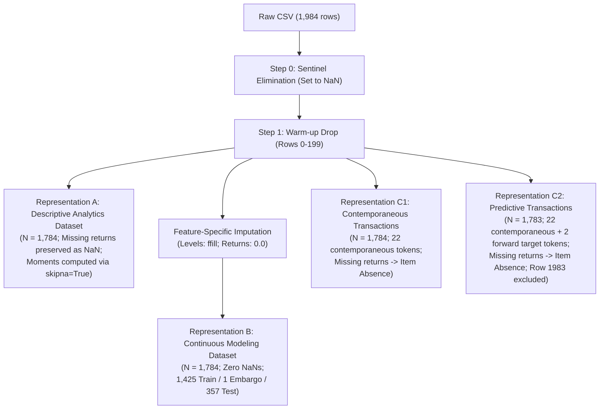

# FINAL IMPLEMENTATION SPECIFICATION (BINDING MASTER DOCUMENT)
*(Fully Reconciled & Audited Version)*

**Project:** Analytics and Systems of Big Data Practice — Endsem Hackathon  
**Institution:** IIITDM Kancheepuram  
**Dataset:** CNNpred (UCI Dataset ID: 554)  
**Status:** BINDING MASTER SPECIFICATION (Supersedes all conflicting recommendations in earlier drafts)  

---

## 0. Global Engineering Rules & Invariants

1. **Deterministic Reproducibility:** Global random seed `42` enforced across Python `random`, `numpy.random`, Scikit-learn estimators, and PySpark sessions.
2. **Strict Causal Boundary (Zero Lookahead Leakage):**
   - Every fitted quantity (imputation parameters, scalers, quantile cutoffs, mutual information rankings, PCA components, `var_smoothing`) must be fitted **strictly on training observations** ($t \in \text{Train}$) and frozen prior to transforming validation/test observations.
   - Backward filling (`bfill`) and global smoothing splines are strictly prohibited.
3. **No Predetermined Modeling Outcomes:** Unit and integration tests must **never assert a modeling outcome** (e.g., asserting that accuracy exceeds a hardcoded threshold, asserting $\ge 2$ clusters, asserting an $\varepsilon$ range, or asserting a specific crossover point). Tests must assert **correctness properties, mathematical bounds, and data leakage absence**.
4. **Empirical Fact vs. Reporting Policy:** All numerical metrics, tables, and inferences in notebooks and the final PDF report must be generated dynamically from code outputs. No results may be fabricated or asserted before execution.

---

## 1. Data Ingestion & Canonical Harmonization

### 1.1 Ingestion & Verification
- Download `cnnpred+cnn+based+stock+market+prediction+using+a+diverse+set+of+variables.zip` directly from the official UCI repository (`dataset ID: 554`).
- Unpack into `data/raw/` and record SHA-256 cryptographic checksums for all five CSVs.
- Harmonize cross-market peer index naming to canonical tokens:
  - `GSPC` (in DJI, NASDAQ) and `S&P` (in NYSE, RUSSELL) $\longrightarrow$ `SP500_Return`
  - `IXIC` $\longrightarrow$ `NASDAQ_Return`
  - `RUT` $\longrightarrow$ `RUSSELL_Return`
  - `NYSE` $\longrightarrow$ `NYSE_Return`
  - `DJI` $\longrightarrow$ `DJI_Return`

### 1.2 Column-Type Registry
Every downstream operation is governed by the structural kind of each column:

| Column Kind | Definition & Units | Constituent Features | Imputation Policy | Downstream Usage |
|---|---|---|---|---|
| **`level_price`** | Raw currency price levels (USD) | `Close`, `EMA_10`, `EMA_20`, `EMA_50`, `EMA_200` | Forward-fill (`ffill`) | Truncate warm-up; transform to stationary spreads (`Close/EMA_k - 1`) for modeling; raw Close for Plot 1 |
| **`level_rate`** | Yield levels & rate spreads (percent / basis points) | `DTB4WK`, `DTB3`, `DTB6`, `DGS5`, `DGS10`, `DAAA`, `DBAA`, `TE1`, `TE2`, `TE3`, `TE5`, `TE6`, `DE1`, `DE2`, `DE4`, `DE5`, `DE6` | Sentinel $\rightarrow$ NaN, then forward-fill (`ffill`) | Plot 7, DBSCAN regime features, transaction spreads ($TE2$, $DE1$) |
| **`return_frac`** | Daily simple return as decimal fraction ($\text{std} \approx 0.005 - 0.016$) | `mom`, `mom1`, `mom2`, `mom3`, `AAPL`…`XOM`, `FCHI`, `FTSE`, `GDAXI`, `HSI`, `SSEC`, `GBP`, `JPY`, `CAD`, `CNY`, peer index returns | Sentinel $\rightarrow$ NaN; Modeling: **0.0**; Descriptive: **NaN**; Transactions: **Item Absent** | NB, DBSCAN, descriptive moments, Plot 2, Plot 4, Plot 9 |
| **`return_pct`** | Daily simple return as percentage ($\text{std} \approx 0.5 - 2.7$) | `Dollar index`, `Dollar index-F`, `EUR`, `AUD`, `NZD`, `CHF`, `Brent`, `WIT-oil`, all `*-F` futures, `XAU`, `XAG` | Sentinel $\rightarrow$ NaN; Modeling: **0.0**; Descriptive: **NaN**; Transactions: **Item Absent** | Scaled for distance metrics; sign for transactions |
| **`rel_change`** | Relative daily change ratio ($\Delta X / X$) | `Volume` ($\Delta V / V$), `CTB3M`, `CTB6M`, `CTB1Y`, `ROC_5`…`ROC_20` | Sentinel $\rightarrow$ NaN; Modeling: **0.0**; Descriptive: **NaN**; Transactions: **Item Absent** | Volume surge transaction item, technical indicators |
| **`metadata`** | Timestamps and string identifiers | `Date` (ISO-8601 str), `Name` (constant str) | None (0 nulls) | Chronological index; `Name` dropped from numerical matrices |

---

## 2. Separation of the Three Data Representations

To ensure theoretical correctness, the pipeline explicitly separates data into three distinct representations:



### Representation A: Descriptive Analytics Dataset (`df_descriptive`)
- **Rows:** Exactly 1,784 observations (rows 200 to 1,983).
- **Rule:** Sentinels are converted to `np.nan`. **Missing values in return and relative change columns are preserved as NaN.**
- **Rationale:** Imputing missing returns with 0.0 distorts the true empirical variance, skewness, kurtosis, and Jarque-Bera normality tests. Statistical moments and correlations must be computed strictly over available trading observations using `skipna=True`.

### Representation B: Continuous Modeling Dataset (`df_modeling`)
- **Rows:** Exactly 1,784 observations (rows 200 to 1,983).
- **Rule:** Uses approved feature-specific imputation:
  - Level features (`level_price`, `level_rate`): Forward-fill (`ffill`).
  - Return and relative change features (`return_frac`, `return_pct`, `rel_change`): Imputed with **0.0** (representing zero price change on closed markets).
- **Rationale:** Machine learning estimators (Naive Bayes, DBSCAN, PCA, VectorAssembler) require dense, non-null numeric feature matrices.

### Representation C: Discrete Transaction Datasets (`transactions_contemp` & `transactions_pred`)
- **Rule:** Unavailable observations (NaN or sentinel) are represented as **item absence** (neither Up nor Down token is added to the day's basket).
- **Contemporaneous Transaction Database:** $N = 1,784$ daily baskets (rows 200 to 1,983), using the 22 contemporaneous tokens.
- **Predictive Transaction Database:** $N = 1,783$ daily baskets (rows 200 to 1,982), using the 22 contemporaneous tokens plus exactly one forward target token (`NextDay_Up` or `NextDay_NotUp`).

---

## 3. Strict Preprocessing & Step 0 Sentinel Elimination

1. **Step 0 Sentinel Elimination (Convert to `np.nan`):**
   - **U.S. Rate/Spread Block:** On 15 U.S. bond market holidays, FRED rates and derived spreads are recorded as 0.0. Identify all rows where $DGS10 == 0.0$, and set all features in `{'DTB4WK', 'DTB3', 'DTB6', 'DGS5', 'DGS10', 'DAAA', 'DBAA', 'TE1', 'TE2', 'TE3', 'TE5', 'TE6', 'DE1', 'DE2', 'DE4', 'DE5', 'DE6'}` to `np.nan`.
   - **London Bullion Holidays (`Gold` = -1.0):** On 40 dates, UK bullion markets were closed and `Gold` return is recorded as `-1.0` (-100% crash). Set `Gold` to `np.nan` whenever `Gold <= -0.99`.
   - **Single-Day Commodity & Canadian Holidays:** Set `Oil` to `np.nan` when `Oil <= -0.99` (`2017-07-03`). Set `CTB3M`, `CTB6M`, `CTB1Y` to `np.nan` when $\le -0.99$ (Canadian Thanksgiving / Remembrance Day).
2. **Step 1 Indicator Warm-Up Truncation:**
   - Truncate rows $0 \le t \le 199$ to remove initial lookback nulls (`EMA_200`), leaving exactly **1,784 clean rows** ($t = 200 \dots 1,983$).
   - Initial condition caveat: `EMA_200` is seeded with `adjust=False`, so weights decay exponentially as $((199/201)^n)$.
3. **Step 2 Imputation for Modeling Data:**
   - Level features: Forward-fill (`ffill`).
   - Return and relative change features: Impute with `0.0`.
   - Backward fill (`bfill`) is strictly prohibited.

---

## 4. Reconciled Train/Test Indexing & Target Formulation

### 4.1 Target Formulation & Terminology
The binary forward directional movement target is defined as:
$$y_t = \begin{cases} 1 & \text{if } Close_{t+1} > Close_t \quad (\textbf{NextDay\_Up}) \\ 0 & \text{if } Close_{t+1} \le Close_t \quad (\textbf{NextDay\_NotUp}) \end{cases}$$
- **Terminology Precision:** $y_t = 0$ is designated as **`NextDay_NotUp`** because it includes non-positive movement ($Close_{t+1} \le Close_t$). In the S&P 500 post-warm-up dataset, this consists of 810 down days (99.88%) and exactly 1 flat day (0.12%, on `2015-05-18`).
- **Final Row Unlabeled:** For original row 1,983 (`2017-11-15`), $Close_{t+1}$ is unobserved. This row has no forward target and is excluded from supervised evaluation.

### 4.2 Exact Reconciled Partition Counts
The 1,783 labeled observations ($t = 200 \dots 1,982$) are partitioned with a 1-row boundary embargo:

| Split Segment | Original Row Indices | Reindexed Post-Warmup Indices | Observation Count | Calendar Date Range | Description |
|---|---|---|---|---|---|
| **Training Split** | Rows 200 to 1,624 | Rows 0 to 1,424 | **1,425** | `2010-10-18` to `2016-06-15` | Chronological 80% training set (up-fraction $\approx 54.25\%$) |
| **Boundary Embargo** | Row 1,625 | Row 1,425 | **1** | `2016-06-16` | Purged row: target uses $Close_{1626}$, so features are purged to prevent test boundary overlap |
| **Test Split** | Rows 1,626 to 1,982 | Rows 1,426 to 1,782 | **357** | `2016-06-17` to `2017-11-14` | Chronological 20% test set (up-fraction = **55.46%**: 198 Up / 159 NotUp) |
| **Sum Labelled** | **Rows 200 to 1,982** | **Rows 0 to 1,782** | **1,783** | `2010-10-18` to `2017-11-14` | Exactly **1,425 + 1 + 357 = 1,783** |
| *Final Unlabeled* | Row 1,983 | Row 1,783 | 1 | `2017-11-15` | Excluded from supervised sets; used in contemporaneous ARM |
| *Total Post-Warmup*| **Rows 200 to 1,983** | **Rows 0 to 1,783** | **1,784** | `2010-10-18` to `2017-11-15` | Full post-warmup observation universe |

---

## 5. Complete 24-Item Transaction Vocabulary Enumeration

The discrete transaction universe comprises **EXACTLY 24 DISTINCT ITEM TOKENS**, split into 22 contemporaneous tokens and 2 forward target tokens:

```
Complete 24-Item Vocabulary Enumeration:
====================================================================================================================
Contemporaneous Tokens (22 tokens, evaluated on day t):
--------------------------------------------------------------------------------------------------------------------
1.  SameDay_Up             : mom_t > 0                                (Daily index return positive)
2.  SameDay_Down           : mom_t < 0                                (Daily index return negative)
3.  Volume_Jump            : Volume_t > Q75_train(Volume)             (Relative volume increase > 75th percentile)
4.  Mom5_Pos               : ROC_5_t > 0                              (5-day Rate of Change positive)
5.  Mom5_Neg               : ROC_5_t < 0                              (5-day Rate of Change negative)
6.  Above_EMA50            : Close_t > EMA_50_t                       (Price above 50-day moving average)
7.  Below_EMA50            : Close_t < EMA_50_t                       (Price below 50-day moving average)
8.  TermSpread_Steep       : TE2_t > Q67_train(TE2)                   (10Y-3M Treasury spread in upper tercile)
9.  TermSpread_Flat        : TE2_t < Q33_train(TE2)                   (10Y-3M Treasury spread in lower tercile)
10. TermSpread_Widening     : TE2_t - TE2_{t-1} > 0                    (Yield curve steepening day-over-day)
11. CreditSpread_High      : DE1_t > Median_train(DE1)                (Baa-Aaa corporate spread above median)
12. CreditSpread_Low       : DE1_t <= Median_train(DE1)               (Baa-Aaa corporate spread below median)
13. CreditSpread_Widening   : DE1_t - DE1_{t-1} > 0                    (Credit default risk increasing day-over-day)
14. USD_Up                 : Dollar index_t > 0                       (U.S. Dollar Index appreciating)
15. USD_Down               : Dollar index_t < 0                       (U.S. Dollar Index depreciating)
16. Gold_Up                : Gold_t > 0                               (Gold bullion return positive)
17. Gold_Down              : Gold_t < 0                               (Gold bullion return negative)
18. Oil_Up                 : Oil_t > 0                                (Crude oil return positive)
19. Oil_Down               : Oil_t < 0                                (Crude oil return negative)
20. Tech_Leaders_Up        : AAPL_t > 0 AND MSFT_t > 0                (Both Apple and Microsoft advancing)
21. Europe_Up              : FTSE_t > 0 AND DAX-F_t > 0               (Both UK and German markets advancing)
22. Asia_Up                : HSI_t > 0 AND Nikkei-F_t > 0             (Both Hong Kong and Japanese markets advancing)
--------------------------------------------------------------------------------------------------------------------
Forward Target Tokens (2 tokens, evaluating forward outcome y_t):
--------------------------------------------------------------------------------------------------------------------
23. NextDay_Up             : Close_{t+1} > Close_t                    (Forward next-day index price increases)
24. NextDay_NotUp          : Close_{t+1} <= Close_t                   (Forward next-day index price decreases/flat)
====================================================================================================================
```

### Transaction Dataset Alignment:
1. **Contemporaneous Database:** $N = 1,784$ baskets ($t = 200 \dots 1,983$). Drawn strictly from the 22 contemporaneous tokens (tokens 1–22). Rules generated here describe market co-movement.
2. **Predictive Database:** $N = 1,783$ baskets ($t = 200 \dots 1,982$). Each basket contains day-$t$ contemporaneous items plus exactly one forward target token (`NextDay_Up` or `NextDay_NotUp`). Row 1,983 is strictly omitted.

---

## 6. Descriptive Analytics & Visualization Plan (12 Curriculum Plots)

All descriptive analytics are performed on **Representation A (`df_descriptive`)**.

### 6.1 Exhaustive Statistical Tables
- Summary statistics computed per-column, per-market: Count, Mean, Std, Median, IQR, Skewness, Kurtosis, Jarque-Bera statistic ($JB$) with p-value, Ljung-Box statistic ($Q_{10}, Q_{20}$) with p-value, Missingness %, and Units.
- Missing values in returns are preserved as NaN and skipped via `skipna=True`.

### 6.2 12 Distinct Course-Taught Visualizations (300 DPI)
1. **Plot 1 (`fig01_normalized_indices.png`):** Multi-Index Normalized Line Plot ($100 \times Close_t / Close_0$).
2. **Plot 2 (`fig02_return_distribution.png`):** Histogram + KDE + Normal Fit of S&P 500 returns (`mom`).
3. **Plot 3 (`fig03_correlation_heatmap.png`):** Spearman Rank Correlation Heatmap of stationary features.
4. **Plot 4 (`fig04_annual_boxplots.png`):** Box-and-Whisker Plot of daily returns grouped by calendar year (2010–2017).
5. **Plot 5 (`fig05_missingness_matrix.png`):** Temporal Missingness Heatmap highlighting NaN locations and holiday sentinels.
6. **Plot 6 (`fig06_rolling_volatility.png`):** 21-Day Rolling Annualized Volatility: $\sigma_{\text{ann}} = \sigma_{21}(\text{mom}) \times \sqrt{252}$.
7. **Plot 7 (`fig07_yield_spreads.png`):** Time Series of cleaned interest rate spreads (`TE1`, `TE2`, `DE1`).
8. **Plot 8 (`fig08_credit_vs_momentum.png`):** Bivariate Scatter Plot with OLS regression: $\Delta DE1_t$ vs. $mom_t$.
9. **Plot 9 (`fig09_autocorrelation_acf.png`):** Stem Plot of Autocorrelation Function (ACF) for $r_t$ vs. $r_t^2$ with Ljung-Box test.
10. **Plot 10 (`fig10_dollar_vs_gold_hexbin.png`):** Hexagonal Binning (Hexbin) Density Plot: U.S. Dollar Index returns vs. cleaned Gold returns.
11. **Plot 11 (`fig11_day_of_week_violin.png`):** Violin Plot of returns by Day-of-Week with Kruskal-Wallis test p-value.
12. **Plot 12 (`fig12_underwater_drawdown.png`):** Area Chart of Cumulative Percentage Drawdown: $DD_t = \frac{W_t - \max W_s}{\max W_s}$, where $W_t = \prod_{\tau=1}^t (1 + mom_\tau)$.

---

## 7. Predictive Analytics: FP-Growth & Pincer Search

### 7.1 FP-Growth Association Rule Mining
- **Mining Engine:** MLxtend FP-Growth with integer count threshold: $\sigma_{\min} = \lceil minsup \times N \rceil$ (operating point $\text{minsup} = 0.10, \text{minconf} = 0.60$).
- **Rule Pruning:** $\text{Lift} > 1.05 \longrightarrow$ remove redundant sub-antecedent rules $\longrightarrow$ remove mirror duplicates $\longrightarrow$ rank by Conviction, then Lift.
- **Rule Separation:**
  - *Predictive Rules:* Consequent $\in \{NextDay\_Up, NextDay\_NotUp\}$. Evaluated out-of-sample on the test period with Fisher exact test and Benjamini-Hochberg FDR correction.
  - *Contemporaneous Rules:* Consequent $\in \{SameDay\_Up, SameDay\_Down\}$. Labeled as market co-movement.

### 7.2 Hardened Lin & Kedem (1998) Pincer Search
- **Implementation:** Bi-directional search with sequential MFCS antichain branching and counting-pruning on integer support counts.
- **Dual Oracle Cross-Validation:**
  $$\text{set}(\text{MFIs}_{\text{Pincer}}) \equiv \text{set}(\text{MFIs}_{\text{fpmax}}) \equiv \text{set}(\text{maximal}(\text{FIs}_{\text{FPGrowth}}))$$
- **Property Testing:** 200 randomized small transaction databases verified against brute force.

---

## 8. Predictive Modeling: Naive Bayes & DBSCAN Regimes

### 8.1 Naive Bayes Classification
- **Models:** Gaussian Naive Bayes (`GaussianNB`) on continuous stationary features; Bernoulli Naive Bayes (`BernoulliNB`) on binarized features.
- **Evaluation:** Strict out-of-sample test split ($N_{\text{test}} = 357$).
- **Metrics:** Accuracy, Balanced Accuracy, Precision, Recall, F1, MCC, ROC-AUC, Brier Score, Reliability Curve.
- **Statistical Tests:** Binomial test of test accuracy against the 55.46% test majority baseline; McNemar test against Majority and Persistence baselines.
- **Classification Rules Output:** Tabulate per-class means and variances ($\mu_0, \mu_1, \sigma_0^2, \sigma_1^2$) and top log-likelihood ratio features.

### 8.2 DBSCAN Volatility Regime Clustering
- **Features:** 5 domain regime features: 21-day realized volatility of returns, 21-day mean return, $TE2$ term spread, $DE1$ credit spread, $\Delta DE1$ credit change.
- **Parameter Selection:** $\text{MinPts} = 2 \times \text{dim} = 10$. Compute k-distance plot ($k = \text{MinPts} - 1 = 9$). Locate optimal $\varepsilon$ knee via `kneed.KneeLocator`.
- **Validation:** Density-Based Cluster Validation (DBCV), silhouette on non-noise points, bootstrap adjusted Rand index (ARI) stability across $\varepsilon \pm 10\%$, calendar strip plot.
- **HAC Dendrogram Companion:** Truncated dendrogram ($p = 30$, Ward's linkage) with Cophenetic Correlation reported.

---

## 9. PySpark MLlib & Big Data Benchmarking

### 9.1 PySpark MLlib Pipelines
1. **PySpark FP-Growth (`pyspark.ml.fpm.FPGrowth`):** Integer support ceiling mining; single-consequent rule equality verified with `mlxtend` within $10^{-9}$.
2. **PySpark Gaussian Naive Bayes (`pyspark.ml.classification.NaiveBayes`):**
   - **MANDATORY:** Set `modelType='gaussian'` (preventing multinomial negative return crash).
   - Prediction agreement $\ge 99.5\%$ with Scikit-learn GaussianNB.
3. **Windows Safety:** All DataFrame outputs exported to disk via `toPandas()`, bypassing `winutils.exe` native write hooks.

### 9.2 Rigorous Benchmarking Protocol
- **Latency Profiling:** Phase-separated timings ($T_{\text{session}}$, $T_{\text{convert}}$, $T_{\text{warmup}}$, $T_{\text{steady}}$, $T_{\text{collect}}$) over $\ge 5$ iterations; report medians and IQRs.
- **Memory Profiling:** Sample Resident Set Size (RSS) across Python driver and Java child processes via `psutil` every 50 ms.
- **Scaling Suites:**
  - Strong scaling: Speedup across CPU cores ($P \in \{1, 2, 4, P_{\max}\}$) with fitted Amdahl $f$.
  - Data scaling: Workloads ($N \in \{1,784; 10,000; 50,000; 100,000; 250,000; 500,000\}$) generated via **bootstrap resampling with per-attribute Gaussian perturbation** ($\sigma = 0.25 \sigma_{\text{train}}$) and re-discretization. Report measured crossover point honestly.

---

## 10. Automated Academic PDF Report Specification

Build `src/generate_pdf_report.py` using ReportLab to render `reports/Analytics_BigData_Endsem_Report.pdf`:
- 18 structured chapters covering Problem Statement, Dataset Provenance, Sentinel Elimination, Descriptive Statistics, 12 Visualizations with Inferences, FP-Growth Rules, Naive Bayes vs Baselines, DBSCAN Regimes & HAC Dendrogram, Pincer Search Dual Verification, PySpark Implementations, Benchmarking & Scalability, Financial Discussion, Limitations, Bibliography, and Technical Appendix.

---

## 11. Master Acceptance Checklist (25 Criteria)

Before declaring implementation complete, all 25 criteria must pass:
- [ ] Raw archive SHA-256 verified; all 5 CSVs loaded with shape $(1984, 84)$.
- [ ] Step 0 sentinel elimination sets US rate holidays ($DGS10 == 0$) and commodity drops ($\le -0.99$) to NaN.
- [ ] Rows 0–199 truncated ($N=1,784$ remaining).
- [ ] Descriptive dataset preserves missing returns as NaN; modeling dataset imputes levels with `ffill` and returns with 0.0.
- [ ] Strict chronological 80/20 train/test split with 1-row boundary embargo ($1,425 + 1 + 357 = 1,783$).
- [ ] Scalers, quantiles, and selectors fitted strictly on training observations.
- [ ] Next-day target constructed as `NextDay_Up` vs `NextDay_NotUp`; last row omitted from supervised sets.
- [ ] All 12 curriculum plots generated, saved at 300 DPI, each with post-rendering inferences.
- [ ] Rolling annualized volatility calculated on returns (`mom`), not price levels.
- [ ] Underwater drawdown calculated on cumulative return compounder.
- [ ] Complete 24-item vocabulary used: 22 contemporaneous tokens for $N=1,784$, 2 forward target tokens for $N=1,783$.
- [ ] FP-Growth rules separated into predictive ($NextDay\_*$) and contemporaneous co-movement.
- [ ] Conviction calculated with explicit handling of $\infty$.
- [ ] Pincer Search implements Lin & Kedem bi-directional search with MFCS antichain branching.
- [ ] **Dual cross-validation passes:** Pincer Search MFIs $\equiv$ `mlxtend.frequent_patterns.fpmax` $\equiv$ `maximal(FP-Growth)`.
- [ ] PySpark `NaiveBayes` configured with `modelType='gaussian'`; passes with $\ge 99.5\%$ Scikit-learn prediction agreement.
- [ ] PySpark `FPGrowth` integer support itemsets and single-consequent rules match `mlxtend` exactly.
- [ ] Synthetic scaling generates data via bootstrap perturbation, not pure replication.
- [ ] Memory profiled via `psutil` process-tree RSS.
- [ ] Benchmarking isolates SparkSession startup overhead from steady-state fit.
- [ ] DBSCAN evaluated via DBCV, non-noise silhouette, and knee locator (no hardcoded cluster counts).
- [ ] HAC Ward linkage dendrogram generated with Cophenetic Correlation reported.
- [ ] Code fully commented with docstrings and mathematical derivations (REQ-09).
- [ ] Automated test suite (`pytest tests/`) passes 100% with exit code 0.
- [ ] Final academic PDF report compiles cleanly ($> 2$ MB) with all 18 chapters and embedded figures.
