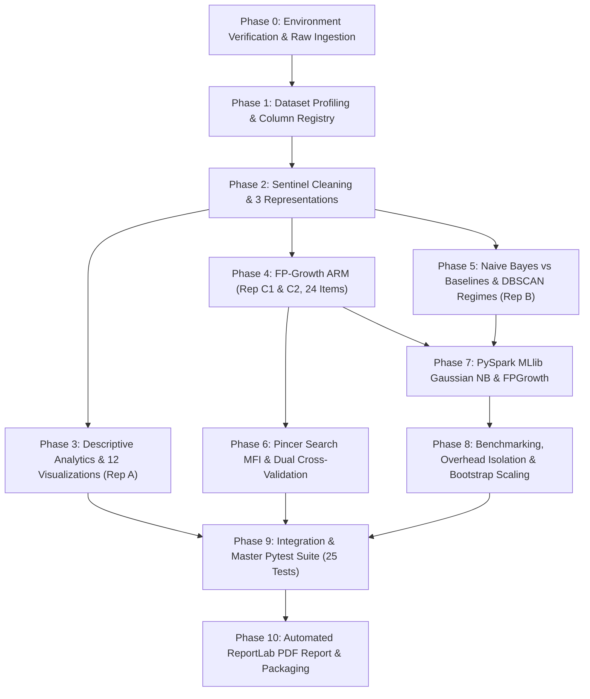

# PHASE-BY-PHASE IMPLEMENTATION ROADMAP
*(Fully Reconciled & Audited Version)*

**Project:** Analytics and Systems of Big Data Practice — Endsem Hackathon  
**Target:** 100% Comprehensive, Verified, Defensible Submission  

---

## Roadmap Overview

---

## Phase 0: Environment Verification & Raw Data Acquisition

- **Objective:** Establish the Python and PySpark runtime environment on Windows, download the official UCI dataset archive, verify file checksums, dynamically detect `JAVA_HOME`, and configure paths.
- **Tasks:**
  1. Verify virtual environment dependencies: `pandas`, `numpy`, `scipy`, `scikit-learn`, `matplotlib`, `seaborn`, `mlxtend`, `kneed`, `pyspark`, `reportlab`, `psutil`, `pytest`. Ensure `numpy < 2` if PySpark 3.5 requires it.
  2. Dynamically detect `JAVA_HOME` at runtime, verifying Java 11 or 17 installation.
  3. Author `src/data_loader.py` to download the official UCI ZIP archive (ID 554) and unpack the 5 CSV files into `data/raw/`.
  4. Compute and log SHA-256 cryptographic checksums for all five raw CSV files.
- **Algorithms & Concepts:** Cryptographic integrity checking, dynamic JVM-Python IPC bridge configuration.
- **Expected Files:**
  - `src/data_loader.py`
  - `data/raw/Processed_S&P.csv`
  - `data/raw/Processed_DJI.csv`
  - `data/raw/Processed_NASDAQ.csv`
  - `data/raw/Processed_NYSE.csv`
  - `data/raw/Processed_RUSSELL.csv`
- **Dependencies:** Python 3.10+, `urllib`, `zipfile`, `hashlib`, Java 11/17 runtime.
- **Expected Outputs:** 5 unpacked raw CSVs in `data/raw/` with verified checksums.
- **Validation Procedure:** Run SHA-256 hash checks; run automated test asserting each file exists, has size $> 1.4$ MB, and has exactly 1,984 lines.
- **Acceptance Criteria:** All 5 CSVs present on disk, readable by Pandas, with non-zero byte size matching UCI specifications.
- **Estimated Time:** 15 minutes.

---

## Phase 1: Dataset Profiling & Column-Type Registry

- **Objective:** Profile all 5 market CSVs, harmonize cross-market column naming inconsistencies, and establish the canonical column-type registry driving downstream pipelines.
- **Tasks:**
  1. Inspect column names, data types, and row indices across all 5 CSVs.
  2. Author canonical schema harmonizer mapping peer index names (`GSPC`/`S&P` $\rightarrow$ `SP500_Return`, `IXIC` $\rightarrow$ `NASDAQ_Return`, `RUT` $\rightarrow$ `RUSSELL_Return`).
  3. Author column-type registry categorizing all 84 columns into structural kinds: `level_price`, `level_rate`, `return_frac`, `return_pct`, `rel_change`, `metadata`, with annotated units.
  4. Document verified spread formulas ($TE5 = DTB3 - DTB4WK$, $TE6 = DTB6 - DTB4WK$, $DE4 = DBAA - DTB6$, $DE5 = DBAA - DTB3$, $DE6 = DBAA - DTB4WK$) and clarify `CTB*` (relative changes) and `Volume` (relative changes).
- **Algorithms & Concepts:** Schema harmonization, metadata registry architecture, dimensional analysis.
- **Expected Files:**
  - `src/data_loader.py` (enhanced with harmonization and registry)
  - `notebooks/01_dataset_exploration.ipynb`
  - `outputs/tables/column_type_registry.csv`
- **Dependencies:** Phase 0 completion.
- **Expected Outputs:** Column-type registry table, harmonized multi-market DataFrames.
- **Validation Procedure:** Assert `df.shape == (1984, 84)` for each file; verify unified column lookup across all datasets.
- **Acceptance Criteria:** 100% column name resolution across all 5 files without dropping any features; full kind categorization.
- **Estimated Time:** 20 minutes.

---

## Phase 2: Sentinel Cleaning, 3 Representations & Embargo Partition

- **Objective:** Execute sequential data cleaning (Step 0 sentinel elimination, warm-up drop), construct the 3 separate data representations, execute chronological partitioning with boundary embargo, select stationary features, and discretize the 24-item transaction vocabulary.
- **Tasks:**
  1. **Step 0 Sentinel Elimination:** In rate/spread block, set rows where $DGS10 == 0.0$ to `np.nan` (15 bond holiday dates); in return/relative-change columns, set values $\le -0.99$ to `np.nan` (40 London bullion holidays in `Gold`, 1 in `Oil`, 15 Canadian holidays in `CTB*`).
  2. **Step 1 Warm-up Truncation:** Truncate rows $0 \le t \le 199$ to remove initial lookback nulls (`EMA_200`), leaving 1,784 clean rows ($t = 200 \dots 1,983$; post-truncation indices $0 \dots 1,783$).
  3. **Step 2 Construct Three Separate Representations:**
     - **Representation A (`df_descriptive`):** $N = 1,784$. Preserves remaining missing returns as NaN. Used strictly for descriptive moments, normality, and curriculum plots via `skipna=True`.
     - **Representation B (`df_modeling`):** $N = 1,784$. Level features forward-filled (`ffill`); return and relative change features imputed with **0.0** (zero change). Zero NaNs remain.
     - **Representation C1 (`transactions_contemp`):** $N = 1,784$ baskets ($t = 200 \dots 1,983$). Uses the 22 contemporaneous tokens; missing returns mapped to item absence.
     - **Representation C2 (`transactions_pred`):** $N = 1,783$ baskets ($t = 200 \dots 1,982$). Uses the 22 contemporaneous tokens plus exactly one forward target token (`NextDay_Up` or `NextDay_NotUp`). Row 1,983 is strictly omitted.
  4. **Step 3 Chronological Partition with Boundary Embargo (on Representation B):**
     - Total labeled rows = 1,783 ($t = 200 \dots 1,982$).
     - **Train Split (80%):** Rows 200–1,624 (reindexed 0–1,424; $N=1,425$; dates `2010-10-18` to `2016-06-15`).
     - **Boundary Embargo:** Row 1,625 (reindexed 1,425; $N=1$; date `2016-06-16`). Purged row preventing test boundary overlap.
     - **Test Split (20%):** Rows 1,626–1,982 (reindexed 1,426–1,782; $N=357$; dates `2016-06-17` to `2017-11-14`).
     - **Check:** $1,425 + 1 + 357 = 1,783$ labeled rows. Test majority baseline = **55.46%** (198 Up / 159 NotUp).
  5. **Step 4 Stationary Feature Engineering:** Exclude raw `Close` and `EMA_*` levels; engineer stationary spreads $(Close - EMA_k) / EMA_k$; prune collinear pairs ($|r| > 0.90$); rank features via Mutual Information inside train.
- **Algorithms & Concepts:** Causal time-series boundary, 3-representation architecture, bifurcated missing value imputation, stationary feature engineering.
- **Expected Files:**
  - `src/preprocessing.py`
  - `src/feature_engineering.py`
  - `notebooks/02_data_preprocessing.ipynb`
  - `data/interim/descriptive_sp500.parquet`
  - `data/processed/sp500_train.parquet`
  - `data/processed/sp500_embargo.parquet`
  - `data/processed/sp500_test.parquet`
  - `data/processed/transactions_contemp.json`
  - `data/processed/transactions_predictive.json`
- **Dependencies:** Phase 1 completion.
- **Expected Outputs:** Representation A, Representation B (train/embargo/test splits), Representation C1 and C2 transaction databases.
- **Validation Procedure:** Assert `train_df.isnull().sum().sum() == 0`; assert no return values $\le -0.99$; assert no zero rates on bond holidays; verify $1,425 + 1 + 357 == 1,783$.
- **Acceptance Criteria:** Complete elimination of sentinels and nulls in modeling data; preservation of NaNs in descriptive data; verified 24-item vocabulary.
- **Estimated Time:** 40 minutes.

---

## Phase 3: Descriptive Statistics & 12 Curriculum Visualizations (Representation A)

- **Objective:** Compute exhaustive descriptive statistics on Representation A (preserving NaNs in returns) and render 12 distinct, curriculum-taught visualizations (300 DPI) with post-rendering inferences.
- **Tasks:**
  1. Compute descriptive statistics table on Representation A: Count, Mean, Std, Median, IQR, Skewness, Kurtosis, Jarque-Bera statistic ($JB$) with p-value, Ljung-Box statistic ($Q_{10}, Q_{20}$) with p-value, Missingness %, and Units across all features using `skipna=True`.
  2. Implement and export 12 curriculum-aligned visualizations to `outputs/figures/`:
     - **Plot 1 (`fig01_normalized_indices.png`):** Multi-Index Normalized Historical Line Plot ($100 \times Close_t / Close_0$).
     - **Plot 2 (`fig02_return_distribution.png`):** Histogram + KDE + Normal Fit of S&P 500 returns (`mom`).
     - **Plot 3 (`fig03_correlation_heatmap.png`):** Spearman Rank Correlation Heatmap of stationary features.
     - **Plot 4 (`fig04_annual_boxplots.png`):** Annual return boxplots (2010–2017) showing volatility contraction.
     - **Plot 5 (`fig05_missingness_matrix.png`):** Missingness matrix highlighting NaN locations and holiday sentinels.
     - **Plot 6 (`fig06_rolling_volatility.png`):** 21-day rolling annualized volatility: $\sigma_{\text{ann}} = \sigma_{21}(\text{mom}) \times \sqrt{252}$.
     - **Plot 7 (`fig07_yield_spreads.png`):** Time series of cleaned rate spreads (`TE1`, `TE2`, `DE1`).
     - **Plot 8 (`fig08_credit_vs_momentum.png`):** Bivariate scatter plot with OLS trendline: $\Delta DE1_t$ vs $mom_t$.
     - **Plot 9 (`fig09_autocorrelation_acf.png`):** Stem plot of Autocorrelation Function (ACF) for $r_t$ vs $r_t^2$ with Ljung-Box test.
     - **Plot 10 (`fig10_dollar_vs_gold_hexbin.png`):** Hexagonal binning density plot: USD Index returns vs cleaned Gold returns.
     - **Plot 11 (`fig11_day_of_week_violin.png`):** Violin plot of returns by weekday with Kruskal-Wallis test p-value.
     - **Plot 12 (`fig12_underwater_drawdown.png`):** Area chart of cumulative percentage drawdown: $DD_t = \frac{W_t - \max W_s}{\max W_s}$.
  3. Author written key inferences for every figure strictly after rendering, referencing exact quantitative plot values.
- **Algorithms & Concepts:** Parametric vs empirical density estimation, moment analysis, time-series autocorrelation decay, cumulative compounding.
- **Expected Files:**
  - `src/descriptive_analytics.py`
  - `src/visualization.py`
  - `notebooks/03_descriptive_analytics.ipynb`
  - `notebooks/04_visualization.ipynb`
  - `outputs/figures/fig01_normalized_indices.png` through `fig12_underwater_drawdown.png`
  - `outputs/tables/descriptive_statistics_table.csv`
- **Dependencies:** Phase 2 completion.
- **Expected Outputs:** 12 publication-grade PNG figures (300 DPI) and comprehensive descriptive statistical tables.
- **Validation Procedure:** Automated script verifying 12 image files exist, each $> 50$ KB, with verified labels and units.
- **Acceptance Criteria:** Exactly 12 distinct curriculum plot types produced, each with a post-rendering written inference.
- **Estimated Time:** 45 minutes.

---

## Phase 4: FP-Growth Association Rule Mining (Representation C1 & C2)

- **Objective:** Mine frequent itemsets using integer count thresholds, extract association rules, calculate Conviction, and separate rules into predictive vs contemporaneous families.
- **Tasks:**
  1. Ingest Representation C1 ($N=1,784$, contemporaneous) and Representation C2 ($N=1,783$, predictive) transaction databases.
  2. Implement FP-Growth pipeline with integer support threshold: $\sigma_{\min} = \lceil minsup \times N \rceil$ (operating point $\text{minsup} = 0.10, \text{minconf} = 0.60$).
  3. Conduct parameter sensitivity grid search: $\text{minsup} \in \{0.05, 0.075, 0.10, 0.15, 0.20\}$; $\text{minconf} \in \{0.50, 0.60, 0.70, 0.80\}$; report itemset counts as a heatmap without selecting from the grid.
  4. Compute Support, Confidence, Lift, and Conviction:
     $$\text{Conviction}(X \Rightarrow Y) = \frac{1 - \text{Supp}(Y)}{1 - \text{Conf}(X \Rightarrow Y)}, \quad \text{handling } \text{Conf}=1.0 \implies \infty$$
  5. Apply rule pruning: Lift $> 1.05 \longrightarrow$ remove redundant sub-antecedent rules $\longrightarrow$ remove mirror duplicates $\longrightarrow$ rank by Conviction, then Lift.
  6. Bifurcate rules:
     - **Predictive Rules (from C2):** Consequent $\in \{NextDay\_Up, NextDay\_NotUp\}$. Evaluate on test period ($N=357$) with Fisher exact test and Benjamini-Hochberg FDR correction ($q = 0.05$).
     - **Contemporaneous Rules (from C1):** Consequent $\in \{SameDay\_Up, SameDay\_Down\}$. Labeled as market co-movement.
  7. Generate Support vs Confidence scatter plot colored by Lift (`fig13_fpgrowth_rules_scatter.png`).
- **Algorithms & Concepts:** FP-Tree construction, conditional pattern bases, integer ceiling thresholds, Benjamini-Hochberg multiple testing correction.
- **Expected Files:**
  - `src/association_rules.py`
  - `notebooks/05_fp_growth.ipynb`
  - `outputs/tables/frequent_itemsets.csv`
  - `outputs/tables/association_rules_predictive.csv`
  - `outputs/tables/association_rules_contemporaneous.csv`
  - `outputs/figures/fig13_fpgrowth_rules_scatter.png`
- **Dependencies:** Phase 2 transaction databases.
- **Expected Outputs:** Formatted tables of predictive and contemporaneous rules, support-confidence scatter plot.
- **Validation Procedure:** Assert support monotonicity; assert confidence and lift match definitions within $10^{-12}$; verify predictive rules evaluate out-of-sample on $N=357$ test split.
- **Acceptance Criteria:** Statistically valid FP-Tree mining with clean separation of predictive and contemporaneous rules.
- **Estimated Time:** 35 minutes.

---

## Phase 5: Naive Bayes Classification & DBSCAN Regime Discovery (Representation B)

- **Objective:** Evaluate Gaussian/Bernoulli Naive Bayes for supervised directional forecasting against test majority baselines, and DBSCAN for unsupervised volatility regime discovery with an HAC dendrogram companion.
- **Tasks:**
  1. **Naive Bayes Classification (`src/classification.py`):**
     - Train `GaussianNB` (on standardized stationary features) and `BernoulliNB` (on binarized features) on training split ($N=1,425$).
     - Predict next-day direction on chronological test split ($N=357$).
     - Compute metrics: Accuracy, Balanced Accuracy, Precision, Recall, F1-Score, MCC, ROC-AUC, Brier Score, Reliability Curve.
     - Conduct formal statistical tests: Binomial test of test accuracy against the 55.46% test majority baseline; McNemar test against Majority and Persistence baselines.
     - Conduct 5-fold expanding-window walk-forward validation as a robustness check.
     - Generate "classification rules" output: per-class means and variances table ($\mu_0, \mu_1, \sigma_0^2, \sigma_1^2$) and top log-likelihood ratio features.
     - Plot Confusion Matrix, ROC Curve, and Reliability Curve (`fig14_naive_bayes_evaluation.png`).
  2. **DBSCAN Clustering (`src/clustering.py`):**
     - Fit on 5-feature domain regime set (21-day realized volatility of returns, 21-day mean return, $TE2$ term spread, $DE1$ credit spread, $\Delta DE1$ credit change) scaled via `StandardScaler`.
     - Set $\text{MinPts} = 2 \times \text{dim} = 10$. Compute k-distance plot ($k = \text{MinPts} - 1 = 9$). Locate optimal $\varepsilon$ knee via `kneed.KneeLocator`.
     - Sweep $\varepsilon \pm 30\%$ around knee; report cluster counts and noise fractions without hardcoded assertions.
     - Validate via Density-Based Cluster Validation (DBCV), silhouette score on non-noise points, bootstrap adjusted Rand index (ARI) stability across $\varepsilon \pm 10\%$, and a calendar strip plot of cluster labels.
     - Plot 2D PCA cluster projection (`fig15_dbscan_regimes.png`).
  3. **HAC Dendrogram Companion:**
     - Generate truncated Hierarchical Agglomerative Clustering Dendrogram ($p = 30$, Ward's linkage) with Cophenetic Correlation reported (`fig16_regime_dendrogram.png`).
- **Algorithms & Concepts:** Gaussian/Bernoulli conditional likelihoods, McNemar test, density reachability, DBCV, Cophenetic correlation.
- **Expected Files:**
  - `src/classification.py`
  - `src/clustering.py`
  - `notebooks/06_naive_bayes_and_dbscan.ipynb`
  - `outputs/tables/classification_metrics.csv`
  - `outputs/tables/clustering_metrics.csv`
  - `outputs/figures/fig14_naive_bayes_evaluation.png`
  - `outputs/figures/fig15_dbscan_regimes.png`
  - `outputs/figures/fig16_regime_dendrogram.png`
- **Dependencies:** Phase 2 preprocessed datasets.
- **Expected Outputs:** Complete classification performance report vs baselines, DBSCAN regime partition, dendrogram visualization.
- **Validation Procedure:** Assert all classification metrics bounded in $[0, 1]$; assert DBCV score computed; assert cophenetic correlation $> 0.60$.
- **Acceptance Criteria:** Rigorous out-of-sample evaluation without pre-asserting model superiority; empirically justified DBSCAN clustering.
- **Estimated Time:** 50 minutes.

---

## Phase 6: Pincer Search for Maximal Frequent Itemsets (MFIs)

- **Objective:** Implement Lin & Kedem (1998) bi-directional Pincer Search with intact $L_k$ join + counting-pruning, and conduct dual oracle cross-validation against `fpmax` and FP-Growth.
- **Tasks:**
  1. Author `PincerSearch` class (`src/pincer_search.py`):
     - Initialize $C_1 = \{\{i\} \mid i \in I\}$, $\text{MFCS} = \{I\}$, $\text{MFS} = \emptyset$.
     - Simultaneous counting pass: count integer supports for $C_k \cup \text{MFCS}$.
     - Counting-Pruning: skip support counting for any candidate $c \in C_k$ subsumed by an established MFI in $\text{MFS}$.
     - Promote frequent MFCS elements to $\text{MFS}$; remove from $\text{MFCS}$.
     - Sequential MFCS-gen for each infrequent set $s \in S_k$, applying immediate child subsumption pruning and discarding empty children ($\emptyset$).
     - Candidate Generation: $C_{k+1} = L_k \bowtie L_k$; Apriori subset prune; prune candidates not covered by at least one element in $\text{MFCS}$.
     - Loop until $C_{k+1} = \emptyset$.
  2. Implement dual oracle cross-validation on Representation C:
     - **Oracle 1:** Assert exact set equality with `mlxtend.frequent_patterns.fpmax`: $\text{set}(\text{MFIs}_{\text{Pincer}}) \equiv \text{set}(\text{MFIs}_{\text{fpmax}})$.
     - **Oracle 2:** Assert exact set equality with maximal itemsets extracted from FP-Growth: $\text{set}(\text{MFIs}_{\text{Pincer}}) \equiv \text{set}(\text{maximal}(\text{FIs}_{\text{FPGrowth}}))$.
  3. Execute 200 randomized property tests (5–12 items, 10–60 transactions) comparing Pincer Search against brute-force maximal itemset discovery.
  4. Instrument and report per-pass $|C_k|$, $|S_k|$, $|\text{MFCS}|$, $|\text{MFS}|$, and candidates pruned compared to Apriori. State exponential worst-case complexity honestly.
- **Algorithms & Concepts:** Lin & Kedem (1998) Pincer Search, Maximal Frequent Itemsets, MFCS antichain branching, dual oracle cross-validation.
- **Expected Files:**
  - `src/pincer_search.py`
  - `notebooks/07_pincer_search_mfi.ipynb`
  - `outputs/tables/pincer_search_mfis.csv`
  - `outputs/tables/pincer_vs_fpgrowth_comparison.csv`
- **Dependencies:** Phase 2 transaction database, Phase 4 FP-Growth itemsets.
- **Expected Outputs:** Complete catalog of MFIs with integer support counts, candidate generation instrumentation, dual cross-validation proofs.
- **Validation Procedure:** Automated pytest assertions verifying $\text{set}(\text{MFIs}_{\text{Pincer}}) == \text{set}(\text{MFIs}_{\text{fpmax}}) == \text{set}(\text{maximal}(\text{FIs}_{\text{FPGrowth}}))$.
- **Acceptance Criteria:** 100% mathematical set equivalence across all three independent implementations on market transactions and random property tests.
- **Estimated Time:** 50 minutes.

---

## Phase 7: PySpark Distributed MLlib Implementations

- **Objective:** Implement distributed versions of two predictive techniques using PySpark MLlib: Distributed FP-Growth and Distributed Gaussian Naive Bayes, ensuring exact mathematical equivalence.
- **Tasks:**
  1. Initialize local `SparkSession` with Windows-safe configurations (`spark.driver.host=localhost`, memory allocation, Arrow enabled).
  2. Implement PySpark FP-Growth pipeline (`pyspark.ml.fpm.FPGrowth`):
     - Ingest unique transaction arrays (`array<string>`).
     - Fit distributed model with integer support threshold.
     - Extract frequent itemsets and assert exact equality with `mlxtend`.
     - Filter `mlxtend` rules to $|consequents| == 1$ and assert exact confidence and lift equality with Spark rules (within $10^{-9}$).
     - Compute Conviction in post-processing.
  3. Implement PySpark Gaussian Naive Bayes pipeline (`pyspark.ml.classification.NaiveBayes`):
     - Assemble continuous feature vector using `VectorAssembler`.
     - **MANDATORY:** Explicitly pass `modelType='gaussian'` (preventing multinomial negative feature crash).
     - Assert prediction agreement $\ge 99.5\%$ with Scikit-learn GaussianNB (with `var_smoothing` set to tiny).
  4. Collect all DataFrame outputs to driver and write to disk via `toPandas()`, avoiding Windows `winutils.exe` native write exceptions.
- **Algorithms & Concepts:** Distributed computing, Spark MLlib Pipelines, Parallel FP-Tree (PFP), Gaussian conditional likelihoods.
- **Expected Files:**
  - `src/pyspark_pipeline.py`
  - `notebooks/08_pyspark_implementation.ipynb`
  - `outputs/tables/pyspark_fpgrowth_rules.csv`
  - `outputs/tables/pyspark_naive_bayes_metrics.csv`
- **Dependencies:** Phase 4 and Phase 5 completion, Java 11/17, `pyspark`.
- **Expected Outputs:** Spark MLlib frequent itemsets, Spark association rules, Spark classification metrics.
- **Validation Procedure:** Assert Spark FP-Growth integer rules match `mlxtend` exactly on single consequents; assert Spark Gaussian NB matches Scikit-learn $\ge 99.5\%$.
- **Acceptance Criteria:** Clean execution of both Spark MLlib pipelines with zero Windows native IO crashes.
- **Estimated Time:** 40 minutes.

---

## Phase 8: Benchmarking & Big Data Performance Analysis

- **Objective:** Conduct rigorous benchmarking comparing Local Python vs PySpark, isolating JVM startup overhead, profiling process-tree memory via `psutil`, and evaluating synthetic scaling generated via bootstrap perturbation.
- **Tasks:**
  1. Author automated benchmark harness `src/benchmark_engine.py` measuring:
     - $T_{\text{session}}$: SparkSession initialization latency.
     - $T_{\text{convert}}$: Pandas to Spark DataFrame conversion (PyArrow enabled).
     - $T_{\text{warmup}}$: First `fit` execution (JIT and Catalyst planning).
     - $T_{\text{steady}}$: Steady-state algorithm execution time (median of $\ge 5$ runs).
     - $T_{\text{collect}}$: Result materialization (`.count()` / `.collect()`).
  2. Implement background daemon thread sampling peak Resident Set Size (RSS) via `psutil` every 50 ms across the full process tree (Python driver + Java child processes). Report configured JVM memory (`spark.driver.memory`).
  3. Strong Scaling Benchmark: Measure execution time across CPU cores ($P \in \{1, 2, 4, P_{\max}\}$) on fixed workload; fit Amdahl's Law speedup model: $S(P) = 1 / ((1-f) + f/P)$.
  4. Data Scaling Benchmark: Evaluate synthetic scaled workloads ($N \in \{1,784; 10,000; 50,000; 100,000; 250,000; 500,000\}$) generated via **bootstrap resampling with per-attribute Gaussian perturbation** ($\sigma = 0.25 \sigma_{\text{train}}$) and re-discretization with frozen thresholds.
  5. Render dual-log scalability plot (`fig17_benchmark_scalability.png`) and report the empirical crossover point as measured (including if no crossover occurs for Naive Bayes).
- **Algorithms & Concepts:** Amdahl's Law, process-tree memory profiling, bootstrap feature perturbation, empirical scalability benchmarking.
- **Expected Files:**
  - `src/benchmark_engine.py`
  - `outputs/tables/benchmark_results_baseline.csv`
  - `outputs/tables/benchmark_results_scaling.csv`
  - `outputs/figures/fig17_benchmark_scalability.png`
- **Dependencies:** Phase 4, Phase 5, Phase 7 completion.
- **Expected Outputs:** Comprehensive benchmarking comparison tables, Amdahl speedup curve, dual-log data scaling curve.
- **Validation Procedure:** Assert benchmark runs $\ge 5$ iterations and reports medians/IQRs; verify memory measures JVM process tree; report empirical crossover honestly.
- **Acceptance Criteria:** Methodologically sound benchmark published with startup overhead separated from algorithm computation.
- **Estimated Time:** 40 minutes.

---

## Phase 9: Integration, Verification & Master Reproducibility

- **Objective:** Integrate all modular components into a single-command master execution script `run_all.py` and execute the 25-test automated pytest suite.
- **Tasks:**
  1. Author master runner `run_all.py` executing the complete pipeline end-to-end (ingest $\rightarrow$ clean $\rightarrow$ describe $\rightarrow$ visualize $\rightarrow$ arm $\rightarrow$ nb/dbscan $\rightarrow$ pincer $\rightarrow$ spark $\rightarrow$ benchmark $\rightarrow$ report).
  2. Author complete automated test suite in `tests/`:
     - `test_data_loader.py`: Raw CSV verification, checksums, schema harmonization.
     - `test_preprocessing.py`: Sentinel elimination, 0 nulls, warm-up truncation, causal split embargo ($1,425 + 1 + 357 = 1,783$).
     - `test_feature_engineering.py`: Stationary spreads, next-day target, complete 24-item transaction vocabulary.
     - `test_fp_growth.py`: Integer support counts, metric definitions, predictive rule out-of-sample check.
     - `test_pincer_search.py`: Lin & Kedem bi-directional search, invariants I1–I3, **dual cross-validation vs `fpmax` and FP-Growth**.
     - `test_classification.py`: Gaussian/Bernoulli NB out-of-sample metrics, majority baseline comparison, binomial/McNemar tests.
     - `test_clustering.py`: DBSCAN on 5 regime features, knee detection, DBCV score, HAC dendrogram cophenetic correlation.
     - `test_pyspark.py`: Spark Gaussian NB parity ($\ge 99.5\%$), Spark FPGrowth exact rule parity on single consequents.
     - `test_benchmark.py`: Overhead isolation, psutil process-tree memory sampling, bootstrap scaling.
     - `test_report.py`: 12 curriculum plots exist ($> 50$ KB), PDF report compiles cleanly ($> 2$ MB).
  3. Execute `pytest tests/` and resolve any regressions.
- **Algorithms & Concepts:** Continuous integration, regression testing, deterministic reproducibility seeds.
- **Expected Files:**
  - `run_all.py`
  - `tests/test_*.py` (10 test modules, 25 formal assertions)
- **Dependencies:** All preceding phases.
- **Expected Outputs:** 100% passing test suite across all modules, single-command master reproduction pipeline.
- **Validation Procedure:** Run `python run_all.py` and `pytest tests/`; assert exit code 0.
- **Acceptance Criteria:** All 25 unit and integration tests pass without warnings or errors.
- **Estimated Time:** 35 minutes.

---

## Phase 10: Final PDF Report & Deliverable Packaging

- **Objective:** Compile the complete, publication-grade academic PDF report (covering all 18 structured chapters) and package the final deliverable bundle.
- **Tasks:**
  1. Author automated PDF compilation engine `src/generate_pdf_report.py` using ReportLab:
     - Styled title page with institutional details (IIITDM Kancheepuram, Course, Endsem Hackathon, Team).
     - Executive summary and problem statement.
     - Dataset profiling, schema analysis, and feature dictionary tables.
     - Preprocessing, sentinel elimination, and bifurcated imputation methodologies.
     - Descriptive statistics summary and all 12 numbered curriculum visualization figures with embedded key inferences.
     - FP-Growth association rules table with predictive vs contemporaneous separation.
     - Naive Bayes classification report, confusion matrix, ROC curves, class likelihood tables, and DBSCAN regime analysis.
     - Pincer Search theoretical formulation, pseudocode, MFIs table, and dual cross-validation proofs.
     - PySpark MLlib distributed implementations (Gaussian NB and PFP).
     - Rigorous benchmarking analysis, Amdahl's law discussion, and scalability figures.
     - Cross-market comparative analysis across S&P 500, DJI, NASDAQ, NYSE, and Russell 2000.
     - Limitations, practical implications, and future research directions.
     - Complete formal academic citations (Hoseinzade & Haratizadeh 2019, Lin & Kedem 1998, Han et al. 2000, Li et al. 2008, Ester et al. 1996).
  2. Compile and render `reports/Analytics_BigData_Endsem_Report.pdf`.
  3. Visually inspect rendered PDF to ensure zero overlapping text, crisp 300 DPI figures, and professional typography.
  4. Package source files and README instructions for final submission.
- **Algorithms & Concepts:** Document layout typesetting, table formatting, vector graphics integration, automated reporting.
- **Expected Files:**
  - `src/generate_pdf_report.py`
  - `reports/Analytics_BigData_Endsem_Report.pdf`
  - `README.md`
  - `requirements.txt`
- **Dependencies:** All outputs from Phases 1 through 8.
- **Expected Outputs:** Fully compiled, 20–30 page professional academic PDF report and clean repository bundle.
- **Validation Procedure:** Verify PDF compiles without error, verify file size ($> 2$ MB), open and visually inspect all embedded figures and tables.
- **Acceptance Criteria:** Flawless PDF report containing all required sections, plots, outputs, parameters, and interpretations.
- **Estimated Time:** 40 minutes.

---

## Overall Timeline Summary

| Phase | Description | Reconciled Estimated Time |
|---|---|---|
| **Phase 0** | Environment Verification & Raw Data Acquisition | 15 mins |
| **Phase 1** | Dataset Profiling & Column Registry | 20 mins |
| **Phase 2** | Sentinel Cleaning, 3 Representations & Embargo Partition | 40 mins |
| **Phase 3** | Descriptive Statistics & 12 Visualizations (Rep A) | 45 mins |
| **Phase 4** | FP-Growth ARM (Rep C1 & C2, 24 Items) | 35 mins |
| **Phase 5** | Naive Bayes vs Baselines & DBSCAN Regimes (Rep B) | 50 mins |
| **Phase 6** | Pincer Search MFI & Dual Cross-Validation | 50 mins |
| **Phase 7** | PySpark MLlib Gaussian NB & FPGrowth | 40 mins |
| **Phase 8** | Benchmarking, Overhead Isolation & Bootstrap Scaling | 40 mins |
| **Phase 9** | Integration & Master Pytest Suite (25 Tests) | 35 mins |
| **Phase 10** | Automated ReportLab PDF Report & Packaging | 40 mins |
| **Total** | **End-to-End Rigorous Implementation** | **~6.8 Hours** |
